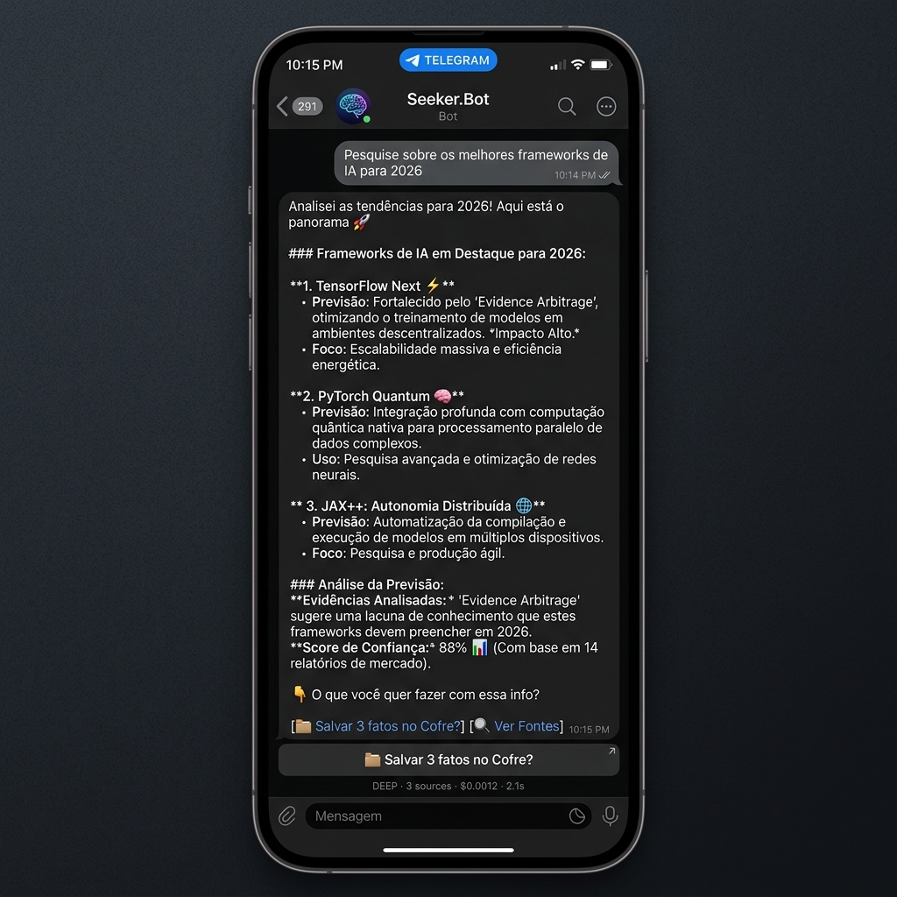
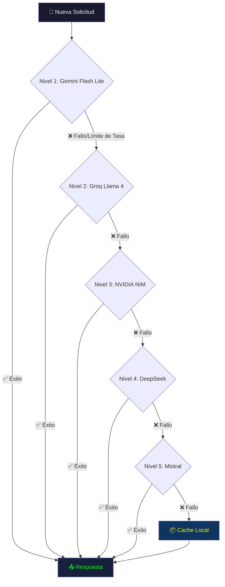
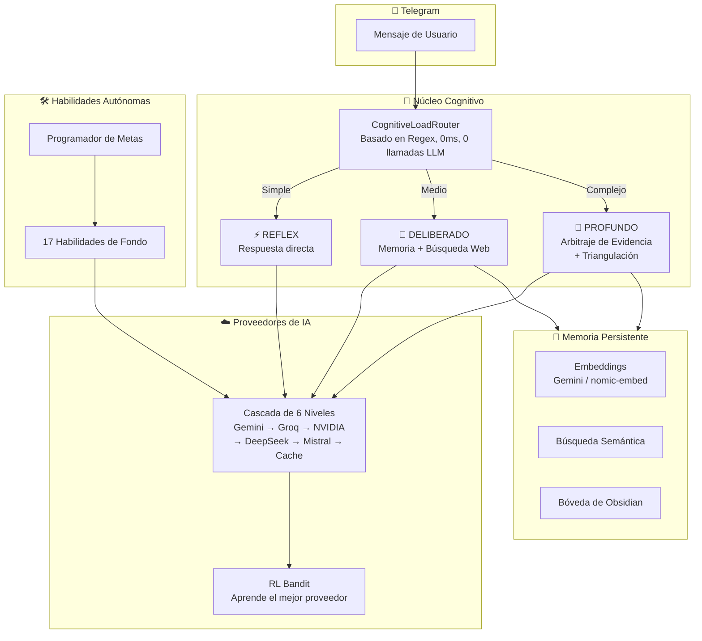

<div align="center">

# 🤖 Seeker.Bot

**Agente cognitivo autónomo para Telegram y WhatsApp con memoria persistente, visión artificial, 9 adaptadores de ejecución y 34 habilidades modulares.**

[](https://python.org)
[](LICENSE)
[]()
[]()

🇧🇷 [Leia em Português](README.pt-BR.md)



</div>

---

## ✨ ¿Qué es Seeker?

Seeker.Bot no es un chatbot, es un **agente cognitivo autónomo** que reside en tu Telegram y WhatsApp. Decide cómo procesar cada mensaje (reflexivo, deliberado o análisis profundo), busca en la web, recuerda todo lo discutido y ejecuta 34 habilidades independientes en segundo plano — desde inteligencia de CRM hasta curación de noticias diarias e ingesta de bóvedas de conocimiento de WhatsApp.

Lo que lo hace diferente: una **cascada de API multi-proveedor (6 niveles)** que nunca deja de funcionar, 9 adaptadores de ejecución portados (`MOA`, `BROWSER_CAMO`, `CRM`, `FIRECRAWL`, `CRONJOB`, etc.), un **Bandit de Aprendizaje por Refuerzo** que aprende qué modelo de IA funciona mejor para cada tarea, un servidor nativo de **Model Context Protocol (MCP)** y **Arbitraje de Evidencia** para detectar alucinaciones.

Puedes ejecutarlo totalmente en la nube con niveles gratuitos de API, o **100% localmente** en tu GPU sin necesidad de internet.

---

## 🆕 Novedades en v3.12-stable

- **Pipeline de WhatsApp Vault (`src/skills/whatsapp_vault/`):** Webhook en tiempo real y polling multi-slot vía Evolution API v2.3.7. Extrae automáticamente 9 tipos de medios (OCR de Florence-2, PyMuPDF, transcripción de Whisper, tablas DOCX/XLSX/PPTX, vCard, geolocalizaciones) y los ingiere directamente en tu Bóveda de Obsidian con deduplicación atómica (`SeenIdsStore`).
- **Panel Interactivo `/wa_config` & `/wa_resend`:** Controla grupos objetivo de WhatsApp, horarios diarios y reprocesamiento de mensajes directamente en Telegram con recarga en caliente (hot-reload).
- **Servidores Nativos MCP & RPC (`src/core/execution/`):** Servidor Model Context Protocol HTTP & SSE transmitible (`POST /mcp`, `GET /mcp/sse`) en el puerto 8000 y JSON-RPC 2.0 en el puerto 8001.
- **9 Adaptadores de Ejecución Portados (`src/core/execution/adapters/`):** Adaptadores de acción modulares que incluyen Mixture of Agents (`MOA`), Automatización de Navegador Camofox, Web Scraping de Firecrawl e Inteligencia de X/Twitter.
- **Orquestador v2 & Watchdogs:** Ejecución simplificada a través de `seeker_orchestrator.py` y `seeker_watchdog.py` con archivos de bloqueo singleton, monitoreo de heartbeat y recuperación automatizada.


---

## ⚡ Inicio Rápido

```bash
git clone https://github.com/4pixeltechBR/Seeker.Bot
cd Seeker.Bot
install.bat
```

El instalador te guiará en todo: asignar nombre a tu asistente, elegir modo nube o local y seleccionar qué habilidades activar.

---

## 🔑 Proveedores de API y Modelos

Seeker utiliza una **cascada multi-proveedor**: puedes usar desde **1 sola clave de API** hasta 6+ proveedores para máxima resiliencia.

### Proveedores

| Proveedor | Modelo | Rol en Seeker | Nivel Gratuito | Obtener Clave |
|---|---|---|---|---|
| **Google Gemini** | `gemini-3.1-flash-lite` | ⚡ RÁPIDO (alta frecuencia) | ✅ 15 RPM, 500/día | [aistudio.google.com](https://aistudio.google.com/apikey) |
| **Google Gemini** | `gemini-3-flash` | 🧠 PROFUNDO + ⚖️ JUEZ | ✅ 5 RPM, 20/día | misma clave |
| **Google Gemini** | `gemini-embedding-001` | 💾 Embeddings (memoria) | ✅ 100 RPM | misma clave |
| **Google Gemini** | `gemini-2.5-flash` | 👁️ VLM Cloud (visión) | ✅ 5 RPM | misma clave |
| **Groq** | `llama-4-scout-17b` | ⚡ RÁPIDO (ultra-rápido) | ✅ 30 RPM, 14.4K/día | [console.groq.com](https://console.groq.com/keys) |
| **NVIDIA NIM** | `deepseek-v4-pro` | 🧠 PROFUNDO + 📝 SÍNTESIS | ✅ 40 RPM, ilimitado | [build.nvidia.com](https://build.nvidia.com/) |
| **NVIDIA NIM** | `nemotron-ultra-253b` | 🧠 PROFUNDO (fallback pesado) | ✅ 40 RPM | misma clave |
| **NVIDIA NIM** | `qwq-32b` | 🔴 ADVERSARIAL (razonamiento) | ✅ 40 RPM | misma clave |
| **NVIDIA NIM** | `gemma-4-31b-it` | ⚖️ JUEZ + 🔴 ADVERSARIAL | ✅ 40 RPM | misma clave |
| **DeepSeek** | `deepseek-chat` | 🧠 PROFUNDO (respaldo pago) | ❌ ~$0.28/1M tok | [platform.deepseek.com](https://platform.deepseek.com/) |
| **DeepSeek** | `deepseek-reasoner` | 🔴 ADVERSARIAL (pago) | ❌ ~$0.28/1M tok | misma clave |
| **Mistral** | `mistral-small-latest` | ⚖️ JUEZ (fallback) | ✅ 2 RPM | [console.mistral.ai](https://console.mistral.ai/) |
| **Ollama** | `qwen3.5:4b` | 👁️ VLM Local (visión offline) | ✅ 100% local | [ollama.com](https://ollama.com/) |

### Escenarios de Configuración

| Escenario | Claves Necesarias | Resultado | Costo Mensual |
|---|---|---|---|
| 🟢 **Mínimo** | 1× Gemini | Funcional, más lento en picos | $0 |
| 🟡 **Recomendado** | Gemini + Groq + NVIDIA | Rápido y resiliente. 3 proveedores gratis | $0 |
| 🔵 **Potencia Total** | Los 5+ proveedores | Máxima velocidad. Cero tiempo de inactividad. RL Bandit optimiza | ~$2-5 (DeepSeek) |
| 🏠 **100% Local** | Ninguna (Solo Ollama) | Offline, privado, sin costo | $0 + GPU |

> **Nota:** Puedes ejecutarlo con una SOLA clave (Gemini). Seeker se adapta y usa lo disponible. Más proveedores = más resiliencia.

---

## 🧠 Cómo funciona la Cascada

Cuando Seeker necesita llamar a un modelo de IA, no depende de un único proveedor. En su lugar, utiliza una **cascada de 6 niveles con fallback automático**:



Un **Bandit de Aprendizaje por Refuerzo** aprende continuamente qué proveedor es más rápido y confiable para cada rol cognitivo (RÁPIDO, PROFUNDO, JUEZ, etc.) y reordena la cascada en tiempo real.

---

## 🏠 Modo 100% Local (Sin Internet)

Seeker puede ejecutarse totalmente en tu computadora **sin claves de API y sin internet**.

### Requisitos
- [Ollama](https://ollama.com/) instalado
- GPU con VRAM suficiente

### Perfiles de VRAM

| Tu VRAM | Modelo RÁPIDO | Modelo PROFUNDO | Visión (VLM) | Embeddings |
|---|---|---|---|---|
| **8 GB** | Qwen 3.5 4B | Qwen 3.5 4B | Qwen 3.5 4B | nomic-embed-text |
| **16 GB** | Qwen 3.5 4B | Gemma 4 12B | Qwen 3.5 4B | nomic-embed-text |
| **24 GB+** | Qwen 3.5 4B | Qwen 3.5 27B | Gemma 4 E4B | mxbai-embed-large |

### Configuración
```bash
# En tu .env:
SEEKER_MODE=local
LOCAL_VRAM_GB=8    # tu VRAM disponible

# Descargar modelos:
ollama pull qwen3.5:4b
ollama pull nomic-embed-text

# Iniciar:
start_watchdog.bat
```

---

## 👁️ Visión Artificial

Seeker puede ver tu pantalla, leer texto de imágenes y comprender contenido visual.

- **Sin GPU:** Establece `GEMINI_VLM_FALLBACK=true` en `.env`. Utiliza Gemini Flash como VLM en la nube.
- **Con GPU (4GB+ VRAM):** Instala [Ollama](https://ollama.com/) + `ollama pull qwen3.5:4b`. 100% gratis y offline.

---

## 🛠️ Habilidades Modulares

Las habilidades son agentes autónomos que se ejecutan en segundo plano según un horario. Eliges cuáles activar durante la instalación.

### 🟢 Core (Siempre Activas)
| Habilidad | Descripción |
|---|---|
| **Monitor de Salud** | Panel de estado del sistema con métricas en tiempo real |
| **Auto-Mejora** | S.A.R.A. — ciclo de auto-curación cada 6 horas |
| **Briefing Diario** | Resumen matutino a las 7am con tu agenda y prioridades |

### 🟡 Recomendadas
| Habilidad | Descripción |
|---|---|
| **Knowledge Vault** | Segundo Cerebro — guarda datos en Obsidian con un toque |
| **Programador** | Programación de tareas en lenguaje natural vía chat |
| **SenseNews** | Curación de noticias del ecosistema IA por nicho |
| **Sherlock News** | Monitoreo de lanzamientos tecnológicos y de modelos |
| **Analizador de Bugs** | Envía un traceback, recibe un análisis de causa raíz |
| **Creador de Skills** | Genera automáticamente nuevas habilidades basadas en patrones recurrentes |

### 🔵 Especialistas
| Habilidad | Descripción | Requiere |
|---|---|---|
| **Monitor de Email** | Monitoreo de bandeja de entrada con filtrado inteligente | IMAP |
| **Desktop Watch** | Vigilancia de pantalla AFK con detección de patrones | VLM |
| **Ejecutor Remoto** | Ejecuta planes complejos con flujo de aprobación | — |
| **Control de OS** | Control de archivos y aplicaciones del sistema operativo | — |
| **Automatización Git** | Auto-backup a repositorio privado de GitHub | Token de GitHub |

---

## 🏗️ Arquitectura



---

## 📋 Guía Completa de Instalación

### Paso 1: Crear un Bot de Telegram
1. Abre Telegram y busca **@BotFather**
2. Envía `/newbot`
3. Elige un nombre (ej., "Mi Seeker")
4. Copia el **TOKEN** — lo necesitarás para el `.env`
5. Para encontrar tu **User ID**: envía `/start` a **@userinfobot**

### Paso 2: Obtener Claves de API
Como mínimo, necesitas **1 clave** (Gemini). Para mejores resultados, obtén 3 (todas gratis):

| Proveedor | Pasos | Enlace |
|---|---|---|
| **Google Gemini** | 1. Inicia sesión con Google → 2. Haz clic en "Create API Key" | [aistudio.google.com/apikey](https://aistudio.google.com/apikey) |
| **Groq** | 1. Crea cuenta → 2. Ve a API Keys → 3. Crea clave | [console.groq.com/keys](https://console.groq.com/keys) |
| **NVIDIA NIM** | 1. Crea cuenta → 2. Ve a cualquier modelo → 3. Haz clic en "Get API Key" | [build.nvidia.com](https://build.nvidia.com/) |

### Paso 3: Clonar e Instalar
```bash
git clone https://github.com/4pixeltechBR/Seeker.Bot
cd Seeker.Bot
install.bat
```

### Paso 4: Configurar `.env`
El instalador abrirá tu archivo `.env`. Completa al menos:
```env
ASSISTANT_NAME=NombreDeTuAsistente
TELEGRAM_BOT_TOKEN=tu_token_de_botfather
TELEGRAM_ALLOWED_USERS=tu_id_de_usuario_telegram
GEMINI_API_KEY=tu_clave_de_gemini
```

### Paso 5: Iniciar
```bash
start_watchdog.bat
```

### Paso 6 (Opcional): Integración con Obsidian
1. Instala [Obsidian](https://obsidian.md/)
2. Crea una bóveda (vault)
3. Establece `OBSIDIAN_VAULT_PATH=C:\Usuarios\TuUsuario\Obsidian\Vault` en `.env`

### Paso 7 (Opcional): Auto-Backup en Git
1. Crea un repositorio **privado** en GitHub
2. Genera un [Personal Access Token](https://github.com/settings/tokens) (scope: repo)
3. Establece `GITHUB_TOKEN` y `GITHUB_REPO` en `.env`

### Paso 8 (Opcional): Monitoreo de Email
1. Ve a [Seguridad de Cuenta de Google](https://myaccount.google.com/security)
2. Activa la Verificación en Dos Pasos
3. Genera una [Contraseña de Aplicación](https://myaccount.google.com/apppasswords)
4. Completa los campos SMTP/IMAP en `.env`

---

## 🛠️ Construido Con

- **[Google Antigravity](https://blog.google/technology/google-deepmind/)** — Entorno de desarrollo impulsado por IA
- **[Claude Code](https://claude.ai/)** — Programación en pareja avanzada con IA
- **[Python 3.10+](https://python.org)** — Runtime principal
- **[aiogram 3](https://aiogram.dev/)** — Framework asíncrono para Bots de Telegram
- **[Ollama](https://ollama.com/)** — Motor de inferencia de LLM local

---

## 🙏 Agradecimientos

Seeker.Bot fue co-creado con IA, y estamos orgullosos de ello.

| Socio | Contribución |
|---|---|
| **[Google DeepMind](https://deepmind.google/)** | Antigravity (Gemini) — entorno de desarrollo principal y co-diseñador de la arquitectura cognitiva |
| **[Anthropic](https://anthropic.com/)** | Claude Code — programación en pareja avanzada, revisiones de arquitectura y generación de código |
| **[Ollama](https://ollama.com/)** | Motor de inferencia local que permite la operación 100% offline |
| **[Groq](https://groq.com/)** | Infraestructura de inferencia ultra-rápida |
| **[NVIDIA](https://nvidia.com/)** | Plataforma API NIM y ecosistema de GPU |
| **[DeepSeek](https://deepseek.com/)** | Modelos de razonamiento profundo rentables |
| **[Mistral AI](https://mistral.ai/)** | Proveedor de respaldo resiliente |

> Este proyecto es un testimonio de lo que sucede cuando un creador humano trabaja junto a herramientas de IA como verdaderos socios — no como reemplazos, sino como amplificadores cognitivos.

---

## 🤝 Contribuir

¡Las contribuciones son bienvenidas! Por favor lee [CONTRIBUTING.md](CONTRIBUTING.md) para las pautas.

1. Haz un fork del repositorio
2. Crea una rama para tu característica (`git checkout -b feature/amazing-feature`)
3. Haz commit de tus cambios (`git commit -m 'Add amazing feature'`)
4. Push a la rama (`git push origin feature/amazing-feature`)
5. Abre un Pull Request

---

## 📜 Licencia

Este proyecto está licenciado bajo la **Licencia Apache 2.0** — consulta el archivo [LICENSE](LICENSE) para más detalles.

```
Copyright 2026 4pixeltech / Victor Machado Mendonça
```

---

<div align="center">

**Construido con 🧠 por [4pixeltech](https://github.com/4pixeltechBR)**

*¡Si Seeker te ayudó, considera darle una ⭐ en GitHub!*

</div>
