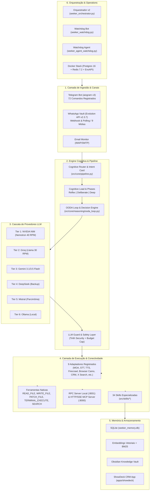

# Seeker.Bot — Visão Geral da Arquitetura (v3.12+)

> Documentação oficial da arquitetura do Seeker.Bot, cobrindo fluxo de mensagens, pipeline cognitivo, adaptadores de execução, servidores MCP/RPC, memória hierárquica e infraestrutura de orquestração.

---

## 🏛️ Visão Geral

O **Seeker.Bot** é um assistente cognitivo e executivo autônomo de classe mundial, orientado a eventos e executado no ambiente Windows/Linux. O sistema integra canais de mensageria (Telegram, WhatsApp, Email), uma engine de roteamento semântico de modelos LLM em cascata (6 provedores/tiers), execução de ferramentas com guardrails de segurança, memória hierárquica híbrida e uma rede extensível de 34 skills e 9 adaptadores de execução.

---

## 🧩 Detalhamento das Camadas

### 1. Ingestão & Canais (`src/channels/`)
- **Telegram (`src/channels/telegram/`):** Interface primária interativa. Utiliza `aiogram v3` com 72 comandos registrados (`HANDLERS_INVENTORY.md`), painéis inline (`/config`, `/wa_config`, `/dashboard`) e suporte a batimentos cardíacos (heartbeat).
- **WhatsApp (`src/channels/whatsapp/`):** Ingestão em tempo real via Webhook e polling agendado (6 janelas diárias). Suporta 9 tipos de mídias estruturadas (imagens, PDFs, ZIPs, áudios, vídeos, documentos Office, vCards, locais, enquetes) integradas diretamente ao Obsidian `Knowledge/`.
- **Email (`src/channels/email/`):** Monitoramento e envio autônomo via IMAP/SMTP.

### 2. Pipeline Cognitivo (`src/core/`)
- **`src/core/pipeline.py`:** Ponto focal do Active Loop. Gerencia o histórico da sessão, injeção de personalidade (`SOUL.md`), captura de tags de ferramentas e re-injeção no loop.
- **Raciocínio & Fases:** Divisão de carga em três regimes:
  - *Reflex (Sistema 1):* Respostas diretas e rápidas para comandos simples.
  - *Deliberate (Sistema 2):* Planejamento e execução encadeada de ferramentas.
  - *Deep (Sistema 3):* OODA Loop complexo com decomposição de sub-metas.

### 3. Cascata de Provedores LLM (`src/providers/`)
- Sistema de tolerância a falhas em 6 tiers. Se uma API atinge rate-limit ou timeout, a requisição sofre fallback gracioso para o próximo nível sem interromper o usuário.

### 4. Camada de Execução (`src/core/execution/`)
- **Adapter Manager (`adapters/manager.py`):** Registra e gerencia 9 adaptadores modulares que podem ser ativados individualmente via `config/.env`.
- **Nativo (`registry.py`):** Operações cirúrgicas de arquivo (`PATCH_FILE`), leitura/escrita e execução de terminal auditada por regras de segurança.
- **MCP & RPC Server:** Servidor HTTP/SSE nativo do Model Context Protocol exposto para clientes externos e servidor RPC local na porta 8001.

### 5. Memória & Armazenamento (`src/core/memory/`)
- **Busca Híbrida:** Combinação de Embeddings Vetoriais (Cosine Similarity) + BM25/TF-IDF para recuperação rápida de contexto em `seeker_memory.db`.
- **Obsidian Vault:** Sincronização direta com a base de conhecimento Obsidian.
- **S.A.R.A. (`self_improvement`):** Sub-sistema de self-healing que executa a cada 6 horas para auto-diagnosticar e corrigir potenciais falhas no bot.

### 6. Orquestração & Infraestrutura (`seeker_orchestrator.py` & Root)
- **`seeker_orchestrator.py` (v2):** Arquitetura simplificada e resiliente. Roda o watchdog do bot Telegram em foreground (herdando a saída do console sem intermediários que possam gerar deadlocks) e o watchdog do agente em background.
- **Watchdogs:** `seeker_watchdog.py` garante execução contínua com lockfile singleton (`logs/watchdog.lock`) e limite contra crash-loops.
- **Docker Stack:** Postgres 16 e Redis 7.2 dedicados para suporte à Evolution API v2.3.7.
